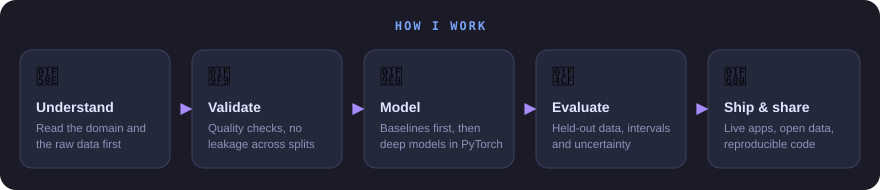

<!-- Header -->

  

  

  
  
  
  
  

<h3 align="center">
  I'm Akhil, a machine learning engineer who loves the research side of ML. 
  I build models, test them honestly, and ship them so people can use them.
</h3>

  

---

## 🎯 What I Do

<table>
  <tr>
    <td width="33%" valign="top" align="center">
      <h3>🧠 Build</h3>
      Deep learning for <b>medical imaging</b>, <b>forecasting</b> and <b>molecules</b>, from raw data to a live app.
    </td>
    <td width="33%" valign="top" align="center">
      <h3>📏 Evaluate</h3>
      Leakage-free splits, strong baselines and <b>uncertainty</b>, so a score means something.
    </td>
    <td width="33%" valign="top" align="center">
      <h3>🔬 Research</h3>
      Open datasets with DOIs, <b>LLM benchmark</b> studies and <b>Kaggle</b> competitions.
    </td>
  </tr>
</table>

  

---

## 🚀 Featured Work

| | Project | What it does | Key result | Links |
|:-:|---|---|---|---|
| 🧠 | **[Brain Tumor Segmentation](https://github.com/akhilnathreddy/brain-tumor-seg)** | Outlines brain tumors in 3D MRI scans and shows where the model is unsure | **Dice 0.90** on unseen patients | [Demo](https://brain-tumor-seg-ml.streamlit.app/) · [Weights](https://www.kaggle.com/datasets/akhilnathreddy/brats2020-unet-segmentation-weights) |
| 🌫️ | **[Delhi-NCR PM2.5 Forecaster](https://github.com/akhilnathreddy/delhi-aqi-forecast)** | Predicts air pollution 72 h ahead from stations, weather and satellite fire data | **−28% error** vs persistence | [Demo](https://delhi-aqi-forecast-ml.streamlit.app/) |
| 🧪 | **[QM9 Curated](https://github.com/akhilnathreddy/qm9-advanced-curation)** | Cleans and audits a classic quantum-chemistry dataset so benchmarks are fair | **133,885** molecules, **8** audited splits | [DOI](https://doi.org/10.5281/zenodo.24105666) · [Kaggle](https://www.kaggle.com/datasets/akhilnathreddy/qm9-curated) |
| 🤖 | **[Gemma 4 Contamination Study](https://www.kaggle.com/datasets/akhilnathreddy/gemma-4-dev-set-contamination-labels)** | Checks whether a coding-agent benchmark leaks its answers, to the model or through the sandbox | **129** tasks labelled | [Data & code](https://www.kaggle.com/datasets/akhilnathreddy/gemma-4-dev-set-contamination-labels) |
| 🤰 | **[COVID-19 & Maternal Health](https://github.com/akhilnathreddy/Pregnant_Women_COVID19)** | Analyses how pandemic stress relates to maternal mental health and birth outcomes | **10.8k** survey records cleaned | [Repo](https://github.com/akhilnathreddy/Pregnant_Women_COVID19) |

  
<b>🔍 More detail on each project</b>

   

**🧠 Brain Tumor Segmentation (BraTS 2020)**: compares a U-Net, an Attention U-Net and a ResNet34 U-Net on a patient-level split of 369 patients. Modality dropout keeps it working when an MRI sequence is missing. The uncertainty map flags errors (AUROC 0.97). Exported to fp16 and ONNX; ~10 s per patient on CPU. Stack: PyTorch, segmentation-models-pytorch, ONNX, Streamlit.

**🌫️ Delhi-NCR PM2.5 Forecaster**: fuses 56 monitoring stations, NOAA GFS weather forecasts and VIIRS satellite fire detections. Compares LightGBM, a Temporal Fusion Transformer and a wind-aware spatio-temporal graph network built from scratch in PyTorch. Evaluated on blocked time folds and a held-out winter. Stack: PyTorch, LightGBM, Streamlit, GitHub Actions.

**🧪 QM9 Curated**: every molecule passes format, chemical-identity, physics and statistical checks and gets a quality tier with machine-readable reasons; no record is deleted. The 8 splits × 5 seeds (scaffold, isomer, ECFP cluster, size and element hold-outs, property tails) keep duplicates and tautomers on one side. `make reproduce` rebuilds the release and checks it against published SHA-256 checksums. Stack: Python, Polars, DVC, Parquet, Croissant.

**🤖 Gemma 4 Contamination Study**: a Google DeepMind Paper Track writeup separating *parametric* contamination (the model memorised the answer) from *environmental* contamination (the sandbox gives it away) across 129 public dev tasks. Labels, probe scores and a script that recomputes every headline number are public.

---

## 🏆 Kaggle

  
  
  

| Status | Competition | Host | My focus |
|:-:|---|---|---|
| 🟢 | [Enveda CASMI 2026: Molecule ID From Mass Spectra](https://www.kaggle.com/competitions/enveda-CASMI26-molecule-id-mass-spectra) | Enveda | Ranking candidate molecules from mass spectra with learned scorers and ensembles |
| 🟢 | [Gemma 4 Developer Agent](https://www.kaggle.com/competitions/gemma-4-developer-agent) | Google DeepMind | Building an autonomous coding agent on Gemma 4 |
| 📄 | [Gemma 4 Developer Agent: Paper Track](https://www.kaggle.com/competitions/gemma-4-developer-agent-paper) | Google DeepMind | Research writeup on benchmark contamination |
| ✅ | [Playground S6E9: Predicting EV Purchases](https://www.kaggle.com/competitions/playground-series-s6e9) | Kaggle | Tabular binary classification (ROC AUC) |

🟢 competing now · 📄 writeup submitted · ✅ completed

**📦 Published datasets:** [QM9 Curated](https://www.kaggle.com/datasets/akhilnathreddy/qm9-curated) · [BraTS 2020 U-Net Weights](https://www.kaggle.com/datasets/akhilnathreddy/brats2020-unet-segmentation-weights) · [Gemma 4 Contamination Labels](https://www.kaggle.com/datasets/akhilnathreddy/gemma-4-dev-set-contamination-labels)

---

## 🧭 Research Interests

| Area | What I care about |
|---|---|
| 📏 **Honest evaluation** | Leakage-free splits, strong baselines, held-out seasons, patients and scaffolds |
| 🎲 **Uncertainty** | Knowing when a model is likely to be wrong |
| 🌐 **Spatio-temporal & graph ML** | Physics-aware features and GNNs for environmental forecasting |
| ⚛️ **Molecular ML** | Data quality, fair benchmarks, structure identification from spectra |
| 🤖 **LLM evaluation** | Benchmark contamination and measuring coding agents fairly |

---

## 🛠️ Tech Stack

| Area | Tools |
|---|---|
| **🧠 ML & DL** |        |
| **📊 Data** |       |
| **🔁 MLOps** |        |
| **📐 Maths** |     |
| **🌐 Web** |      |

  
<b>🌐 Web projects (where I started)</b>

   

  - [Portfolio](https://github.com/akhilnathreddy/portfolio): Next.js + Three.js personal site ([live](https://portfolio-tau-eight-72.vercel.app))
  - [ConnectHub](https://github.com/akhilnathreddy/connectHub): JavaScript web app ([live](https://connect-hub-seven.vercel.app))
  - [ShopSmart](https://github.com/akhilnathreddy/shopsmart) and [Shopping Cart](https://github.com/akhilnathreddy/shoppingcart) ([live](https://shoppingcart-five-liard.vercel.app)): e-commerce apps
  - [Project CI](https://github.com/akhilnathreddy/project-ci): CI pipelines with GitHub Actions

---

## 📊 GitHub Activity

  

  

---

## 🤝 Let's Connect

  Open to <b>Machine Learning Engineer</b> and <b>ML research</b> roles and collaborations. 
  Happy to talk about evaluation, medical imaging, forecasting, molecular ML or LLM benchmarks.

  
  
  

  

